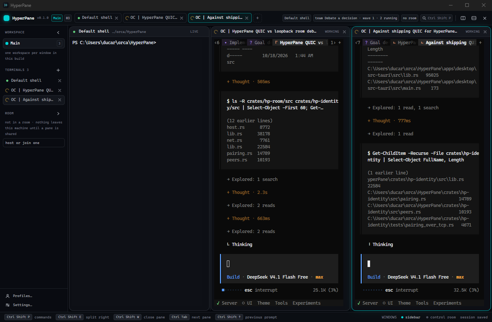

# HyperPane

Không gian làm việc terminal ưu tiên cục bộ: mỗi pane có thể là một shell, một
coding agent, hoặc một máy khác — và các agent có thể làm việc theo nhóm mà
không cần server.

HyperPane chạy trên máy của bạn. Không tài khoản, không thuê bao, không telemetry,
không server: pane, lượt chạy agent và control room chỉ là phối hợp giữa các tiến
trình bạn tự mở, trên những máy bạn với tới được.

[English](README.md)



## Hiện đã làm được gì

- **Pane và bố cục.** Tab, chia pane theo cả hai chiều, kéo vách ngăn, chuyển
  focus bằng bàn phím hoặc chuột, profile shell riêng cho từng pane, và phiên
  làm việc sống qua lần khởi động lại. Bố cục là cây tỉ lệ nên co giãn theo mọi
  kích thước cửa sổ.
- **Tích hợp shell.** OSC 7 và OSC 133 cho header biết thư mục làm việc, mã thoát
  và thời gian chạy của lệnh vừa rồi, đồng thời cho phép nhảy giữa các prompt
  trong scrollback.
- **Agent trong pane.** HyperPane khởi động những CLI bạn đã cài — Claude Code,
  Codex, opencode, Gemini CLI, Qwen Code, Cursor Agent — cấp cho mỗi agent một
  pane, một nhiệm vụ, và một worktree khi nhiệm vụ có ghi file. Dòng `RESULT` do
  agent tự in được đọc lại thành một **claim**, hiện cạnh pane và giữ lại sau khi
  pane đóng. Mỗi lần mở agent đều bị giới hạn và ghi vào audit log chỉ-thêm.
- **Team.** Preset — *Duyệt độc lập*, *Xây một tính năng*, *Tranh luận một quyết
  định* — chạy agent theo wave, sau các cổng. Mỗi thành viên nhận một bản brief
  ghi rõ vai trò, phạm vi và nơi ghi findings; wave sau nhận claim và findings của
  wave trước, nên người duyệt trả lời đúng một phát hiện thay vì trả lời bản mô tả
  về nó. Wave checker giữ lượt chạy lại cho tới khi người dùng quyết định đạt hay
  không.
- **Worktree.** Agent có ghi file chạy trên nhánh `agent/<id>` trong worktree
  riêng; worktree sạch xoá được bằng một cú click, worktree còn thay đổi cần xác
  nhận lần hai, và worktree đang có pane chạy thì không xoá được. Nhánh không bao
  giờ bị xoá.
- **Plugin MCP.** Client cho cả hai thế hệ giao thức; plugin là chương trình bạn
  đã có. Quyền được hỏi rõ ràng và hỏi lại khi bộ tool của server thay đổi.
- **Control room.** Luật do host quyết định, chạy trên TCP: ai tham gia, thấy pane
  nào, được làm gì. **Chỉ loopback và chưa xác thực**; panel nói rõ điều đó.
- **Nền tảng pairing.** Danh tính ed25519 lấy public key làm tên máy, mã pairing
  trao đổi ngoài kênh, và `peers.json` ghim các máy đã ghép. Chưa có gì dùng tới
  phần này — room vẫn nhận bất kỳ ai kết nối được.
- **Tự làm việc trên chính nó.** `Work on HyperPane…` mở source của app trong một
  pane; `Update from source…` chạy `git pull --ff-only`, `pnpm install` và build
  ngay trong pane nhìn thấy được, dừng lại nếu một bước hỏng. Trên Windows, bước
  link cuối không xong được khi app đang chạy, và pane ghi rõ lệnh cần chạy sau
  khi thoát.
- **Reload không mất việc.** Reload UI sẽ nối lại PTY đang sống và phát lại phần
  output gần nhất; không khởi động lại shell hay agent.

## Chưa làm

- Room qua QUIC và việc chỉ nhận máy đã ghim danh tính (room hiện là TCP, loopback).
- Token meter, budget guard, thẻ duyệt mở agent.
- Mật khẩu truy cập thường trực, quyền tạm thời, *My computers*, relay tự host.
- Self-update có chữ ký. Nó cần một kênh phát hành và khoá ký giữ mãi mãi; chưa có
  thì cập nhật nghĩa là pull và build lại source.
- Delivery `pastedAfterStart` đã khai báo nhưng chưa có phía gõ nội dung.

`TODO.md` là danh sách chuẩn, kể cả các khoảng trống trên và lý do.

## Công nghệ

| Lớp | Lựa chọn |
|---|---|
| Vỏ app | Tauri v2 (Rust) |
| PTY | `portable-pty` (ConPTY trên Windows, `openpty` trên Unix) |
| Frontend | React 19 + TypeScript + Vite |
| Giao diện | Tailwind v4 + token thiết kế OKLCH |
| Terminal | `@xterm/xterm` + renderer WebGL |
| IPC | lệnh Tauri + `Channel` streaming, kiểu sinh từ Rust |
| Team | preset thuần dữ liệu (`presets/teams.json`) + router theo wave |
| Room | TCP, JSON phân cách bằng newline, host quyết định (QUIC dự kiến) |
| Danh tính | cặp khoá ed25519; tên máy chính là public key |

## Bố cục mã nguồn

```
hyperpane/
├─ apps/desktop/       App Tauri: UI React + lệnh và state Rust
├─ crates/
│  ├─ hp-pty/          Phiên PTY, registry pane, giải mã UTF-8 tăng dần
│  ├─ hp-core/         Pane id, cây bố cục, workspace, profile
│  ├─ hp-agents/       Danh mục agent, adapter khởi chạy, bộ đọc claim
│  ├─ hp-teams/        Preset team, plan, brief, wave, cổng, router
│  ├─ hp-shell/        Sinh script tích hợp shell (OSC 7 / OSC 133)
│  ├─ hp-store/        Lưu phiên làm việc, ghi nguyên tử
│  ├─ hp-mcp/          MCP client qua stdio (cả hai thế hệ giao thức)
│  ├─ hp-room/         Luật room, vòng lặp host và client
│  └─ hp-identity/     Cặp khoá thiết bị, trao đổi pairing, peer đã ghim
├─ presets/            Preset team + JSON schema
├─ scripts/            Gate kiểm tra, wrapper MSVC, chụp cửa sổ, icon
├─ docs/               Ghi chú kiến trúc
└─ .github/workflows/  CI: fmt, clippy, test, typecheck, build
```

## Yêu cầu

- **Node 22+** và **pnpm 11** (`corepack enable pnpm`)
- **Rust stable** kèm `rustfmt` và `clippy` (`rustup` đọc `rust-toolchain.toml`)
- **Windows**: Visual Studio Build Tools với workload C++ **và Windows SDK**.
  Chỉ C++ tools là không đủ: link sẽ hỏng với
  `LNK1181: cannot open input file 'kernel32.lib'`. WebView2 có sẵn trên Windows
  hiện hành; máy cũ cần cài runtime.
- **macOS**: Xcode command line tools
- **Linux**: `webkit2gtk-4.1`, `libayatana-appindicator3`, `librsvg2`, `libssl`,
  `libxdo`, `patchelf`, `build-essential`

Trên Windows, target MSVC của Rust cần `link.exe` trên `PATH`, thứ mà shell
thường không có. `scripts/with-msvc.ps1` tìm bản Visual Studio đã cài, nạp môi
trường mà `vcvars64.bat` thiết lập, rồi chạy lệnh bên trong. Dấu `--` giữ cho các
flag của cargo (`-p`) không bị PowerShell hiểu thành tham số:

```powershell
.\scripts\with-msvc.ps1 -- cargo test --workspace
```

## Phát triển

```bash
pnpm install
pnpm dev                 # chỉ frontend (Vite) trên :5173
pnpm tauri dev           # app desktop đầy đủ
```

```powershell
# Một crate, hoặc một test theo tên
.\scripts\with-msvc.ps1 -- cargo test -p hp-teams
.\scripts\with-msvc.ps1 -- cargo test -p hp-teams a_three_case_debate

# Một file frontend
pnpm --filter @hyperpane/desktop exec vitest run src/lib/panes.test.ts

# Toàn bộ điều repo cam kết: fmt, clippy -D warnings, cargo test,
# typecheck, vitest, build frontend. Dừng ở bước đầu tiên không đạt.
.\scripts\check.ps1
```

Ba điều cần biết trước lần build đầu:

- **`apps/desktop/dist` phải tồn tại trước mọi lệnh cargo biên dịch crate app.**
  `tauri-build` đọc `frontendDist` lúc biên dịch và hỏng khi thư mục chưa có. CI
  build frontend trước vì lý do này.
- **Bản debug nạp `devUrl`** (`http://localhost:5173`). Chạy Vite trước khi chạy
  `target\debug\hyperpane.exe`, hoặc dùng `pnpm tauri dev`. Vite có thể chỉ bind
  `::1`, nên kiểm tra `127.0.0.1` có thể báo sai là không tới được.
- Trên Windows, file exe đang chạy bị khoá: phải tắt app trước khi build lại.

## Build bản release

```powershell
pnpm install
pnpm --filter @hyperpane/desktop build
.\scripts\with-msvc.ps1 -- cargo build --release -p hyperpane --features custom-protocol
```

Feature `custom-protocol` là thứ nhúng frontend đã build vào binary. Thiếu nó,
bản release vẫn giữ `devUrl` của chế độ phát triển và mở `localhost:5173` — nơi
không có gì chạy, nên cửa sổ hiện lỗi kết nối. `pnpm tauri build` tự bật feature
này và tạo luôn bộ cài cho nền tảng; nếu gọi `cargo build` trực tiếp thì phải ghi
rõ.

Kết quả là `target\release\hyperpane.exe` (hoặc binary tương ứng trên macOS và
Linux). Nó chạy được mà không cần Vite.

## Dữ liệu và quyền riêng tư

Mọi thứ app lưu nằm trong một thư mục dữ liệu — trên Windows là
`%APPDATA%\app.hyperpane.desktop`; đặt `HYPERPANE_DATA_DIR` để đổi chỗ. Trong đó
có `session.json` (bố cục, profile, pane nào chạy agent nào), `audit.log` (JSON
từng dòng, chỉ thêm), `findings/` của các lượt team, `plugins.json`, `trust.json`,
`peers.json` và danh tính thiết bị.

Không có gì được gửi đi đâu. Control room chỉ nghe trên loopback cho tới khi một
người mở nó; pairing trao đổi id ngoài kênh, không qua server.

## Lộ trình

| Giai đoạn | Nội dung | Trạng thái |
|---|---|---|
| **P0** | Khung Tauri, design system, lớp PTY, pane terminal, tab, split | xong |
| **P1** | Workspace, profile, tích hợp shell, keybinding, palette | xong, còn thiếu thời gian chạy lệnh của PowerShell |
| **P2** | Danh mục agent, claim, worktree, giới hạn, audit, pha chạy | xong; token meter và budget guard chưa có |
| **P3** | Team engine: wave, cổng, vai trò, brief, findings, tranh luận | xong |
| **P4** | Plugin hub (MCP) và consent | xong; chữ ký thì không tự phát minh |
| **P5** | Control room | luật + TCP trên loopback; QUIC chưa có |
| **P6** | Mesh: danh tính, pairing, quyền, *My computers* | mới có nền tảng danh tính và pairing |
| **P7** | App làm việc trên chính nó | có pane source và update-from-source; self-update có chữ ký chưa có |

## Nguyên tắc thiết kế

1. **Local-first.** Không tính năng nào bắt buộc phải có server. Không có gì rời
   khỏi máy trừ khi một người mở nó ra.
2. **Con người cầm lái.** Agent không có cờ bỏ qua, không tự đóng pane, không
   merge hay deploy. Mỗi lần mở agent đều do người xác nhận, và wave checker chờ
   người quyết định.
3. **Claim không phải sự thật.** Thứ agent in ra được hiện đúng như nó nói, kèm
   file nó đã ghi. App không nâng một báo cáo thành một kết quả đã kiểm chứng.
4. **Công việc có biên.** Mọi lượt chạy tự động đều có giới hạn: số tiến trình
   sống, tốc độ mở, thời gian, và sau này là ngân sách.
5. **Mọi thứ đều được ghi.** Nếu audit log không ghi được thì hành động không xảy ra.

## Giấy phép

MIT

---

Bản tiếng Anh là bản chuẩn của tài liệu này: [README.md](README.md).
